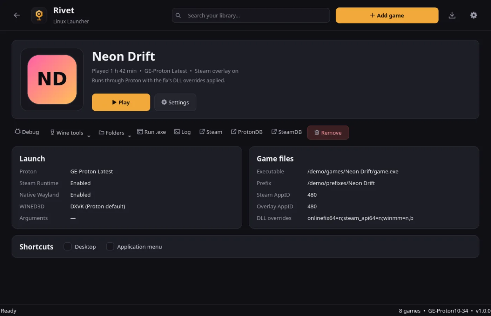

# Rivet

[](https://github.com/ne1i/rivet-launcher/actions/workflows/release.yml)
[](https://github.com/ne1i/rivet-launcher/releases/latest)
[](LICENSE)
[](flake.nix)

**A native Linux launcher for games with OnlineFix, FreeTP, EOSFix and custom
multiplayer fixes.**

Rivet puts the game, its fix, Proton, Steam and the right Wine environment
together in one click. It is a C++20 / Qt 6 rewrite of
[ZzEdovec/onlinefix-linux](https://github.com/ZzEdovec/onlinefix-linux), with no
JRE, JavaFX, Electron or browser runtime.

**Website:** https://ne1i.github.io/rivet-launcher/



> **Legal notice:** Rivet does not host or distribute games, cracks or fixes.
> You must own the games you run and comply with copyright, anti-circumvention,
> contract and local law. Read [`DISCLAIMER.md`](DISCLAIMER.md). Not legal advice.

## Why Rivet

- **Fast and native.** One compiled Qt 6 binary; no embedded runtime and no
  animations.
- **Your library already works.** It migrates the old `OFME-Linux` INI files to
  a structured JSON config on first start.
- **Everything configured for you.** DLL overrides, Steam overlay, Steam Linux
  Runtime, native Wayland, prefix and Proton version.
- **Maintained feature set.** Fix detection, RAR and installer support, Proton
  management, downloads, shortcuts, logs and play time.

## Features

- Library with covers, icons, search, play time and a game page.
- Add extracted games, RAR archives, FreeTP/OnlineFix installers, or downloads
  from a Hydra/OnlineFix JSON source through `aria2c`.
- OnlineFix / FreeTP / EOSFix detection and patches:
  - `OnlineFix.ini` / `SteamFix.ini` AppIDs and `ExtraProtection`
  - FreeTP SteamFix section patch
  - Photon Launcher `Newtonsoft.Json.dll`
  - `winmm.txt` / `dlllist.txt` overrides
  - FreeTP “bypass Steam not running” shim
- Proton browser: list, download, unpack and remove GE-Proton builds, with CPU
  architecture filtering.
- Steam auto-start/sign-in, overlay injection, Steam Linux Runtime, native
  Wayland, WINED3D.
- Per-game launch arguments, environment variables, DLL overrides, prefix,
  cover and icon.
- Wine tools, run any `.exe` in the prefix, game logs, desktop/menu shortcuts.
- Back navigation with mouse Back/Forward, `Esc` and `Alt+←/→`.

## Install

### Release binary

Download `rivet-linux-x86_64` or `rivet-linux-aarch64` from the
[latest release](https://github.com/ne1i/rivet-launcher/releases/latest), then:

```bash
chmod +x rivet-linux-x86_64
./rivet-linux-x86_64
```

Every push to `master` publishes a fresh build with both architectures and
SHA-256 checksums. The binary is dynamically linked against Qt 6; install the
runtime helpers you need for your use case.

### Dependencies

Required:

- native **Steam** (not Flatpak or Snap)
- **Qt 6** (Core, Gui, Widgets, Network, Concurrent, Svg)
- **unrar** for RAR archives
- **7z** for icon extraction fallback
- **tar** for GE-Proton archives
- **aria2** for game downloads

Optional: **ffmpeg** (icon conversion), **icoextract** (better icons),
**winetricks** (Wine tools menu).

Arch Linux:

```bash
sudo pacman -S --needed base-devel cmake qt6-base qt6-svg steam unrar 7zip \
    ffmpeg icoextract winetricks aria2
```

### Nix

```bash
nix run github:ne1i/rivet-launcher
nix build github:ne1i/rivet-launcher
```

Enable flakes once if your Nix still requires it:

```bash
mkdir -p ~/.config/nix
printf 'experimental-features = nix-command flakes\n' >> ~/.config/nix/nix.conf
```

Run Nix as your user, not with `sudo`. The flake is built in CI. `unrar` is
unfree and can be added explicitly on NixOS:

```nix
nixpkgs.config.allowUnfree = true;
environment.systemPackages = [ pkgs.unrar ];
```

### Arch Linux (AUR)

AUR packaging for `rivet-launcher-git` is in
[`packaging/aur/rivet-launcher-git`](packaging/aur/rivet-launcher-git). It is a
VCS package and automatically tracks the latest `master` commit. It is not
published on AUR yet.

### From source

```bash
cmake -S . -B build -DCMAKE_BUILD_TYPE=Release
cmake --build build -j"$(nproc)"
sudo cmake --install build
```

This installs `rivet`, the desktop entry and the icon.

## Configuration

Rivet uses one versioned JSON document:

```
$XDG_CONFIG_HOME/rivet/config.json     # ~/.config/rivet/config.json
$XDG_DATA_HOME/rivet/                  # ~/.local/share/rivet/
  ├── covers/
  ├── icons/
  ├── protons/
  └── prefixes/
```

Environment variables are a real object, launch data is grouped, and the whole
file is validated and written atomically.

```json
{
  "format": "rivet",
  "version": 1,
  "settings": {
    "default_proton": "GE-Proton Latest",
    "paths": { "protons": "", "prefixes": "" },
    "new_games": { "native_wayland": true, "wined3d": false }
  },
  "games": [
    {
      "name": "Example Game",
      "executable": "/games/Example/Example.exe",
      "game_dir": "/games/Example",
      "prefix": "/games/Example/Rivet Prefix",
      "proton": "GE-Proton Latest",
      "environment": { "LC_ALL": "fr_FR.UTF-8" },
      "steam": { "app_id": "12345", "overlay_app_id": "480" },
      "features": { "steam_overlay": true, "steam_runtime": true }
    }
  ]
}
```

On first start, if `~/.config/rivet/config.json` does not exist, Rivet converts
`~/.config/OFME-Linux/Games.ini` and `Launcher.ini` automatically. Covers and
icons are copied into the new data folder; existing Proton and prefix folders
are reused in place. The old files are left untouched.

## Command line

```text
rivet                              Open the launcher
rivet --launch "Game name"         Launch a game directly
rivet "Game name"                  Same as --launch
rivet --list                       List games and executables
rivet --print-command "Game name"  Print the Proton command and environment
rivet --version                    Show the version
```

`--print-command` is useful for debugging environment or override issues without
starting a game.

## Development

```bash
cmake -S . -B build -DRIVET_BUILD_TESTS=ON
cmake --build build -j"$(nproc)"
ctest --test-dir build --output-on-failure
```

The headless test covers legacy INI → JSON migration, structured environment
values, the add-game pipeline and a JSON round-trip.

Project layout:

```
src/core/    config, Proton, fixes, launcher, installers, HTTP
src/ui/      Qt Widgets UI
docs/        static GitHub Pages site
packaging/   desktop entry, icon, AUR files
tests/       headless core test
```

## Legal

Rivet is not affiliated with Valve, Steam, OnlineFix, FreeTP, EOSFix or any game
publisher. It does not host or distribute games or fixes. You are responsible
for owning your games and for complying with copyright, anti-circumvention,
contract and local law. Using third-party fixes with Steam may violate its terms
and can lead to account restrictions.

Read [`DISCLAIMER.md`](DISCLAIMER.md) and [`THIRD_PARTY.md`](THIRD_PARTY.md).

## License

GNU Affero General Public License v3.0. See [`LICENSE`](LICENSE).
